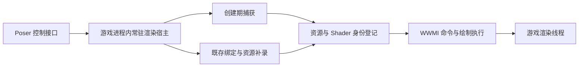

# XXMI 晚附加衣服加载预调研方案

日期：2026-10-27。状态：待执行。

预调研要回答：当鸣潮已经以 DX11 进入场景、目标角色已经显示过，且此前没有加载 XXMI 或渲染记录组件时，能否通过 Poser 的注入入口接入渲染运行时，在当前角色上启用衣服 Mod，并在同一游戏进程中停用、恢复和再次启用。

交付物是可复核的实验结果、原型与继续开发的判断。基础绘制替换、完整衣服支持和同角色多实例换装分别验收。当前已能通过 XXMI 启动游戏，只能作为早期加载对照，不能代替场景内晚附加验证。

## 目标与边界

首轮采用以下约束：

- Poser 与游戏可以按任意顺序启动；游戏先启动的路径不能依赖提前放置的代理 DLL、XXMI 或游戏内记录器。
- 一次晚附加验收从进入场景到停用、再次启用，使用同一 PID、同一次进程创建时间和同一有效渲染设备。不能通过重启游戏或强制重建设备规避接管。
- 必须在附加前已经出现的演员上验证。切换到新角色或创建新演员可用于辅助研究，但不能替代此项。
- 首轮针对 DX11。已运行在 DX12 的进程需要不同渲染后端，单纯加载 DX11 DLL 不满足目标。
- 同一版本运行时支持 Poser 关闭后重新连接；运行中升级不同版本的原生模块另行评估。
- 实验可分别从干净游戏进程开始，以排除上一轮状态。每个实验内部仍遵守不重启要求。

本轮不以同角色多实例独立换装、任意第三方 Mod 全覆盖为通过条件。完整爱弥斯样例的 RabbitFX、Shape Keys 和扩容需求属于单独实验，必须取得对应结果才能宣布支持该样例。

## 已有基础

源码基线固定如下。实验开始时还需记录实际编译提交、工作树状态和产物摘要。

| 项目 | 基线 | 用途 |
| --- | --- | --- |
| WWPoser | `3400c3e5165267076b040084e70e51913b55d828` | 注入、演员生命周期、MMD 和原生物理控制 |
| XXMI 库 | `a7847eae82aaac32175c9a7d199673d5c9323bcd`，发布版 1.2.2 | 绘制 Hook、命令执行、资源追踪及替换 |
| WWMI | `f3a618a7fc035c2fbd31cef34a8156752fe00b16`，发布版 1.1.0 | 绘制入口、骨骼与 Shape Keys 处理 |
| WWMI Tools | `5bd6fa4f16cf8e675a1d273ca2aa2f97a1d00ffb` | Merged 和 Per Component 导出模板 |
| RabbitFX | 8.3.2 | 当前衣服使用的 Pixel Shader 修改与特效接口 |

现有 Poser 已导出 Actor、Mesh、Asset、Skeleton 和 AnimInstance 身份，可用于限定目标演员；它尚未建立这些对象与实际 GPU 资源的映射。现有兼容定义范围见[游戏兼容定义](GAME_COMPATIBILITY.md)。

XXMI 对未知资源的 `GetResourceHash` 返回 0，已有 Context 的追踪字段也不会自动反映附加前的绑定。`IASetInputLayout` 还存在把参数当作包装对象的路径。因此，接入必须补充既存对象登记、状态同步及原生对象透传。[资源查询](https://github.com/SpectrumQT/XXMI-Libs-Package/blob/a7847eae82aaac32175c9a7d199673d5c9323bcd/DirectX11/ResourceHash.cpp#L844)、[Context 与 InputLayout](https://github.com/SpectrumQT/XXMI-Libs-Package/blob/a7847eae82aaac32175c9a7d199673d5c9323bcd/DirectX11/HackerContext.cpp#L1575)。

## 关键问题

| 问题 | 需要取得的证据 | 未解决时的处理 |
| --- | --- | --- |
| 能否捕获真实游戏的 Swapchain 与 Context | 与游戏窗口、设备及实际 Draw 对应的对象记录 | 停止增加 Mod 功能，先解决真实对象接入 |
| 能否理解已有绑定和原生对象 | 初始绑定快照、后续绑定事件与实际 Context 查询一致 | 保持原绘制透传，修复状态或类型处理 |
| 目标绘制是否来自既存命令列表 | Context 类型、录制及提交事件，目标 Draw 的真实调用路径 | 单独研究旧列表路径，不能用未来 Draw Hook 已安装代替证明 |
| 能否恢复目标资源的身份 | 描述、内容或引擎资产来源，以及可重算的匹配依据 | 只保留候选记录，不启用该资源替换 |
| 能否恢复旧 Shader 的可靠身份和代码 | 引擎持有数据或其他可靠来源与实际 Shader 对象的对应关系 | 限定支持范围，单独报告 RabbitFX 和 Shape Keys 缺口 |
| 能否在运行中替换容量不足的资源 | Buffer、SRV、UAV 的生产和消费链路及恢复记录 | 不将扩容样例计入已支持范围 |
| 能否在同一进程中反复使用 | 停用、再次启用和 Poser 重连的连续记录 | 修复宿主生命周期后再扩大覆盖 |

## 接入结构

Poser 使用统一控制接口。早接入时保留可获得的创建期数据；晚接入时执行既存对象补录，两条路径进入相同的资源登记与命令执行层。



宿主按进程身份维持单实例与版本握手。Poser 断开连接时停用其会话的替换；同版本 Poser 再次打开时连接既有宿主。基础 Hook 可驻留至游戏退出，避免把关闭界面等同于卸载正在执行的 DLL。

已有原生对象优先采用原始句柄加旁路元数据的方式管理。未知句柄允许正常透传；元数据需处理 COM 引用、对象释放和地址复用。接管范围还需审计游戏实际使用的 Draw、Dispatch、Present、更新复制、延迟 Context、命令列表及 Swapchain 重建路径。

资源读回、状态查询、绑定变更和 Mod 自定义绘制通过渲染线程或与游戏协同的串行调度执行。Worker 负责准备和控制消息，不能并发操作游戏正在使用的 immediate context。[D3D11 线程要求](https://learn.microsoft.com/en-us/windows/win32/direct3d11/overviews-direct3d-11-render-multi-thread-intro)。

## 样例与对照

| 样例 | 内容 | 用途 |
| --- | --- | --- |
| 原画面对照 | 同一角色、场景、镜头及画质，关闭替换 | 判断附加本身是否改变画面和帧时间 |
| 最小纹理样例 | 一个已知目标绘制的纹理替换 | 验证旧资源识别、命令入口及状态恢复 |
| 基础网格样例 | 无 RabbitFX 和 Shape Keys 依赖的已验证衣服 | 验证骨骼读取及网格替换主线 |
| 完整目标样例 | 爱弥斯 A Romance of Night Chant Basic 与 RabbitFX 8.3.2 | 评估当前实际需求的完整覆盖 |

所有 Mod 样例先通过正常 XXMI 启动方式建立画面对照。未经该对照确认的样例，不能用于判定晚附加成功或失败。

当前爱弥斯包的原始 ZIP SHA-256 为 `c5e9763089874fa120ce0da07e415c8266f89da4980eb3891fcdc317d76e0d2c`。实验需保留原包、当前安装版 INI 及二者差异，并记录以下条件：

- 该包使用 42,106 个 Shape Key 顶点，包含 `override_vertex_count` 和 RabbitFX 调用。
- 原包缺少 4 张引用贴图。当前安装版已禁用对应替换并使用游戏原贴图；对照实验也必须使用相同变体。
- `$mesh_vertex_count` 在原 INI 中分别定义为 104459 和 175929；`Position.buf` 按 float3 计算为 104459 个顶点。实验前需确认解释器的实际取值和相关读写范围，不能据此直接选一个数覆盖。
- RabbitFX 包含旧 Pixel Shader 的 Pattern 与 Replace。绕开 WWMI 全 VS 入口不能单独证明 RabbitFX 可用。

基础网格样例若暂未取得，应将其列为待准备项，不能默认把完整爱弥斯包当作无额外依赖的样例。个人 Mod 资源保留在本地，源码仓库只保存调研代码、清单格式和结果摘要。

## 实验顺序

### 实验 0 建立有效对照

记录游戏构建、资源档位、显卡驱动、分辨率、帧率限制、Mod 清单及 INI 摘要。通过正常 XXMI 启动方式验证样例，记录站立、简单动作、表情、阴影、描边、透明材质和远近镜头效果。

为晚附加实验重新建立没有 XXMI 或渲染记录组件的游戏进程，使目标角色在 DX11 场景中显示。仅看到加载了 `d3d11.dll` 不能证明游戏使用 DX11，应通过实际游戏 Swapchain 对应的设备接口确认。

通过条件：得到有效的早期加载对照，以及可复现的无预加载 DX11 场景。样例原本就异常时，先单独解决样例问题。

### 实验 1 接管已有渲染对象

沿用 Poser 的注入入口加载实验宿主，捕获真实游戏对象，并在渲染边界取得已有绑定。将包装对象与原生对象混合传入的路径逐项检查，尤其是 InputLayout、Shader 和资源视图。

此阶段保持原绘制透传，覆盖游戏实际发生的调用类型；记录初始化前后的绑定、调用计数、线程和设备身份。初始化工作应脱离 `DllMain` 的加载器锁。

先记录实际加载模块，已有外部 XXMI 的会话归入早期加载对照；避免重复运行两套绘制替换链。同步确认 immediate 与 deferred context 的使用，以及目标绘制是否来自附加前录制的命令列表。命令列表的录制和提交是不同阶段，后来接入 Draw Hook 不能自动补录已完成的列表；还需同步 `ExecuteCommandList` 对 Context 状态的保留或重置。[录制与提交语义](https://learn.microsoft.com/en-us/windows/win32/direct3d11/overviews-direct3d-11-render-multi-thread-render)、[Context 状态规则](https://learn.microsoft.com/en-us/windows/win32/api/d3d11/nf-d3d11-id3d11devicecontext-executecommandlist)。

通过条件：实际游戏 Draw 与 Present 可持续观察，旧对象路径正常，原画面保持一致，退出或停用控制不会留下不完整的接管状态。仅观察到测试设备或注入成功不算通过。

### 实验 2 恢复资源身份

从目标绘制取得 VB、IB、骨骼 CB、纹理及相关视图，按资源来源分别验证：

1. 创建时无初始数据的 Buffer：确认创建规则后，验证描述 Hash 路径。
2. Immutable Buffer：结合不可变语义和内容读回，验证原有算法与描述的重算结果。
3. 其他静态或动态资源：分析更新、复制、流送及引擎保留数据，说明身份恢复所依赖的额外依据。
4. 纹理：单独处理格式、子资源、行间距和所启用的 Hash 算法，不能套用 Buffer 算法。

XXMI 的 Buffer Hash 在有初始数据时使用初始内容加描述，无初始数据时使用描述。当前动态内容不必等于创建期内容。[创建期 Hash](https://github.com/SpectrumQT/XXMI-Libs-Package/blob/a7847eae82aaac32175c9a7d199673d5c9323bcd/DirectX11/HackerDevice.cpp#L2143)、[资源使用语义](https://learn.microsoft.com/en-us/windows/win32/api/d3d11/ne-d3d11-d3d11_usage)。

读回按候选和预算排队，缓存有证据的结果；记录同步等待和资源更新失效，避免在每次 Draw 上重复 Copy 与 Map。

通过条件：至少一个最小样例所需的匹配信息可以重算，并在资源重建后重新识别。描述相似、绘制次数接近或直接填入 Mod 期待的 Hash，都不能作为可靠身份。

### 实验 3 在既有演员上启用基础替换

开发 WWMI 专用绘制入口，在真实 Draw 中运行资源匹配和命令列表，并保留原游戏 Shader。验证 pre 与 post 顺序、`handling=skip`、自定义 `drawindexed`、防重入及状态恢复。

同时接入主要 Swapchain 的帧边界、帧计数和 `[Present]`；其他窗口或 Swapchain 的 Present 不能重复推进同一套帧状态。先完成最小纹理替换，再完成基础网格样例，检查骨骼合并的跨帧状态。

通过条件：附加前已存在的角色在同一 PID 中产生可见且正确的替换，动作和相关绘制阶段跟随正常；关闭后恢复原绘制，再次开启仍正确。另行生成新演员不能代替这项结果。

### 实验 4 评估完整爱弥斯样例

在实验 3 通过后，分别处理三项完整支持需求：

- **旧 Shader**：为 RabbitFX 所需 Pixel Shader，以及 Shape Keys 所需 Compute Shader，建立实际对象与可靠身份、代码来源的对应关系。官方 Shader 缓存或磁盘代码若可用，也需验证与当前运行对象的对应关系。
- **Shape Keys**：确认 Loader 与 Multiplier 的计算阶段，验证原有 Hash 路径或经过验证的等价入口。仅按 UAV 槽位或 Dispatch 数量猜测阶段不足以启用替换。
- **运行中扩容**：建立足够容量的 Buffer 和视图，追踪生产、消费、清零、复制及绑定链；游戏持有旧对象时，也必须保持数据流一致，并验证停用后的行为。

通过条件：以实验 0 的同一安装变体为对照，身体、表情、透明材质、RabbitFX 效果及相关绘制阶段达到一致。取得基础换装结果但这三项仍有缺口时，只能报告基础能力可行。

### 实验 5 验证持续使用

基础样例通过实验 3 后即可执行本实验，无需等待完整衣服通过实验 4。

对已通过的样例，在同一 PID 内执行至少 5 次启用、停用和再次启用，并执行至少一次 Poser 关闭再打开。补测角色隐藏后重新出现、演员销毁重建、镜头远近和窗口尺寸变化。

首轮维持同一有效设备；设备丢失及新设备恢复作为后续覆盖项，发生时必须记录，不能算作既有设备晚接管通过。记录关闭或失联时的控制策略、回退结果、对象释放和资源数量。

通过条件：没有重复宿主、旧会话误控制或跨对象复用，停用后原绘制可持续运行，稳定循环中的资源数量没有持续累积趋势。多实例独立换装仍单独研究。

## 证据与结果文件

实验产物建议存放于被 Git 忽略的 `analysis/xxmi_late_attach/<run>/`，每轮包含：

```text
environment.json
attach_events.jsonl
initial_bindings.json
resource_identity.jsonl
shader_identity.jsonl
replacement_resources.jsonl
lifecycle.jsonl
frame_times.csv
captures/
result.json
```

每轮记录 PID 与进程创建时间、源码与 DLL 摘要、宿主代次、设备与 Context 身份、线程、调用类型及 Mod 配置摘要。对象记录区分“接管时已有绑定”“接管后观察到创建”和“来源未知”，未知来源不能自动认定为既存对象。

资源记录至少包括描述、可见区域、Hash 算法、来源依据、匹配值、采样帧、更新失效和释放情况。Shader 记录区分仅取得对象、已确认身份、已取得可验证代码三个阶段。跨进程或跨资源代次复用指针不能作为成功证据。

截图或视频需覆盖附加前、启用、动作中、停用和再次启用，并通过时间戳或帧号关联事件。文件生成、Hook 计数、Hash 命中和画面验收分别报告。

性能记录区分准备阶段和稳定替换阶段，至少包含展示帧间隔、CPU 回调耗时、资源读回等待和资源占用。对照使用相同场景与设置，各采样至少 60 秒，报告中位数、p95 和 p99；展示帧间隔不能标成 GPU 执行时间。预调研先定位额外开销来源，产品化门槛根据实测制定。

游戏进程启动、注入与画面实验需在用户确认当前游戏状态后执行；UAC 由用户处理，实际外观由用户观察确认。离线单元测试仅覆盖 Hash、登记、生命周期和状态逻辑，不能替代实机结果。

## 继续或停止条件

| 结果 | 决策 |
| --- | --- |
| 实验 1 至 3 通过，既有角色可重复替换和恢复 | 进入限定范围 MVP 设计，列明已支持的 Mod 行为 |
| 基础替换通过，完整爱弥斯样例存在明确的 Shader 或扩容缺口 | 继续定向研究该缺口，单独估算完整衣服支持 |
| 只能依靠新建演员、切换后首次创建资源或提前加载 XXMI 才生效 | 尚未达到晚附加目标，保留实验记录并调整接入路径 |
| 资源身份或 Shader 阶段只能猜测，或接管持续破坏原绘制 | 停止扩大功能，先解决证据和接管问题 |
| 实验内部必须重启游戏或重建设备才能恢复 | 本轮不通过，重新评估资源和宿主生命周期 |

首轮建议设置 10 个工作日的探索预算：对照与环境 1 日，既存对象接管 3 日，资源身份 3 日，基础替换与结果整理 3 日。实验存在前后依赖，实际分配按发现调整。完整爱弥斯样例和完整生命周期在基础路径通过后追加预算；首轮到期即提交已取得证据、未解决问题及下一轮建议，不把探索预算当作功能交付日期。

最终交付包含：实验原型及构建说明、各项问题的证据、支持范围、完整样例的缺口，以及继续、追加研究或更换路线的明确建议。

## 后续实现落点

通过基础实验后再确定模块边界，预期需要的职责如下：

| 职责 | 与现有代码的关系 |
| --- | --- |
| Poser 渲染宿主连接与版本握手 | 新增独立连接层，复用进程身份与注入基础 |
| DX11 既存对象接入与旁路登记 | 新增或修改 XXMI 接入层，逐项审计原包装对象假设 |
| WWMI 绘制与计算入口 | 复用命令执行能力，新增经验证的晚附加入口 |
| 鸣潮 RHI 与 Shader 来源适配 | 将经过验证的游戏布局和函数参数纳入兼容定义及指纹管理 |
| Mod 能力与资源匹配清单 | 与游戏字段偏移分开管理，保存每个样例的依赖与匹配依据 |
| 演员与渲染资源关联 | 复用现有演员导出，逐步增加关联证据；不以角色 ID 替代实例身份 |

预调研期间保持现有 MMD 默认链路和发布包不变。实验原型独立构建，基础路径通过后再讨论产品界面、预设字段和发行包集成。
